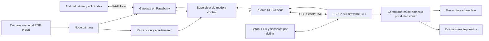

# Plan de arquitectura Raspberry Pi + ESP32-S3

Fecha: 2026-11-19. Propuesta para revisión e implementación por etapas. Consolida los acuerdos del chat técnico y el código de banco, sin declarar la integración física terminada.

## Cambio de plataforma por presupuesto

El 2026-11-19 el usuario fijó Raspberry Pi 3 Model B como plataforma disponible, sustituyendo la Pi 5. Tiene 1 GB RAM. Mantener Ubuntu Server 24.04 arm64 + ROS 2 Jazzy ros-base como base propuesta, con operación por consola/SSH propuesta en la revisión de vídeo; escritorio ligero opcional y seguir [la guía de microSD e instalación](instalacion.md). Revalidar memoria y latencia de cámara, detector, identificador, ROS y vídeo Android en conjunto antes de prometer rendimiento. La distribución Raspberry/ESP se mantiene. Pi 5 y NUC quedan como referencias históricas, no hardware presupuestado actual.

## Vídeo y consola

La revisión del 2026-11-19 propone operar Ubuntu Server sin GUI y compartir cámara por ROS 2. Ver [opciones, flujo y piloto de vídeo](video-ros-pi3.md). Primer candidato integrado: nodo de cámara más web_video_server; la decisión concreta depende de modelo/formato y mediciones en Pi 3B. Android conserva su app nativa y necesita un adaptador al flujo ROS. No hay streaming ROS desplegado todavía.

## Objetivo y alcance

Implementar seguimiento local de la persona enrolada, mando manual de laboratorio y visualización Android, manteniendo una sola autoridad de movimiento en la Raspberry y una parada independiente en la ESP. Conservar la separación entre experimentos, captura de datos y operación. No incorporar navegación global, SLAM, nube ni búsquedas con desplazamiento.

Se verificó la [HU de hardware](https://trello.com/c/P9X0XPYL), en To Do, y GitHub sin issues abiertos en la consulta del 19 de noviembre. No se modificaron tarjetas ni estados. La existencia de código local no prueba que esté publicado, desplegado o validado.

## Arquitectura física



La Raspberry puede sustituirse por el NUC conservando interfaces. La cámara se conecta al computador principal. El teléfono se comunica con ese computador, no directamente con los GPIO de la ESP. La alimentación de motores se diseña por separado de la alimentación regulada de lógica; no se transporta por USB ni por protoboard.

## Responsabilidades

| Equipo/módulo | Responsabilidad | Límites |
| --- | --- | --- |
| Android | Mostrar vídeo y estado confirmado; solicitar modo manual, enrolamiento, confirmación, cancelación y parada | No autoriza movimiento por sí mismo ni asume que una respuesta HTTP significa que el robot se movió |
| Raspberry: cámara | Abrir la cámara una sola vez, fechar imágenes y compartirlas | Panel e IA no abren simultáneamente el mismo dispositivo |
| Raspberry: percepción | Detección, galería fija, comparación de identidad, asociación temporal, enrolamiento y datos locales | No escribir PWM ni publicar directamente órdenes de base |
| Raspberry: supervisor/control | Validar modo, identidad, distancia, vigencia y feedback; arbitrar mando manual/seguimiento | Único publicador de `/base/cmd_vel`; sin rearme automático |
| Raspberry: puente serie | Convertir velocidades a consignas de banco, transportar comandos vigentes y recibir estado | Sin decisiones de identidad; no presentar duty como velocidad medida |
| ESP32-S3 | PWM, dirección, verificación de trama, sesión/secuencia, caducidad y arranque detenido; después botón/LED/sensores definidos | Sin cámara, modelos de IA ni ROS 2 completo |
| Controladores de potencia | Conmutar corriente de motores con límites y disipación adecuados | El L298N disponible no queda aprobado para la carga declarada |

ROS 2 se ejecuta en Linux. La ESP usa C++ con ESP-IDF y USB serie. micro-ROS no es necesario para esta primera integración. Python/rclpy para cámara, percepción, gateway y primer control; medir antes de considerar rclcpp. El C++ del firmware y el procesamiento de redes neuronales son responsabilidades distintas.

## Sistema y organización de la Raspberry

El usuario indica que parece tener Ubuntu. Falta confirmar versión, arquitectura, cámara y servicios instalados. Preferencia inicial: Ubuntu Server 24.04 de 64 bits y ROS 2 Jazzy ros-base, si cámara y equipo son compatibles. La [documentación de Jazzy](https://docs.ros.org/en/jazzy/Installation/Ubuntu-Install-Debs.html) ofrece paquetes para Ubuntu 24.04 arm64/amd64. No elegir otra distribución ROS ni reinstalar antes de inspeccionar el equipo.

Organización de despliegue propuesta, pendiente de crear:

```text
~/LUMI/                    clon del repositorio y código
~/lumi_ws/                 workspace colcon cuando existan paquetes ROS
~/LUMI/.venv/              herramientas offline, fuera de Git
~/LUMI/datos/              capturas, galerías y resultados, fuera de Git
```

Al integrar rclpy, usar el Python compatible con los paquetes ROS del sistema. No mezclar un entorno de otra versión de Python con rclpy. Crear paquetes ament/colcon por responsabilidad cuando se integre ROS; el puente actual es un módulo Python ejecutable y todavía no un conjunto de paquetes ROS desplegado. Configuración de dispositivo, geometría y límites debe quedar separada de la lógica.

## Nodos e interfaces propuestos

Los contratos nuevos de esta tabla se concretarán al implementarlos; no son rutas HTTP o mensajes ya disponibles. Las interfaces de base indicadas sí corresponden al código de banco actual.

| Nodo | Suscribe/recibe | Publica/responde |
| --- | --- | --- |
| `lumi_camera` | Dispositivo y configuración de cámara | `/camera/image_raw` (`sensor_msgs/Image`), timestamp de captura |
| `lumi_percepcion` | Imagen y solicitudes de enrolamiento | `/percepcion/objetivo`, `/percepcion/estado`; esquema propio pendiente |
| `lumi_supervisor` | Objetivo/estado, solicitudes Android, botón y feedback base | `/base/cmd_vel` (`geometry_msgs/TwistStamped`), estado autorizado y petición de habilitación al puente |
| `lumi_puente_serie` | `/base/cmd_vel`, servicio actual `/base/habilitar_banco` (`std_srvs/SetBool`) | `/base/estado` (`std_msgs/String` con JSON del firmware) |
| `lumi_gateway` | Vídeo compartido, estado autorizado y feedback | HTTP/JPEG para Android y solicitudes hacia supervisor/percepción |

Objetivo visual mínimo: timestamp, identidad de sesión, bbox, validez, error lateral, distancia en metros y bandera de validez de distancia. Una puntuación de similitud no es una probabilidad calibrada. No usar altura del recuadro como distancia sin calibración. La cámara de doble lente no se considera estéreo/de profundidad hasta confirmar modelo, sincronía y calibración.

El feedback actual de base informa órdenes aceptadas, armado, modo banco, uptime y fallos de enlace. No mide RPM, avance, corriente, batería o temperatura de motores. Esas medidas solo podrán publicarse cuando exista el hardware correspondiente. Un sensor de proximidad frontal tampoco identifica por sí mismo a la persona.

## Transporte, tiempos y parada

El [protocolo L1 existente](../software/comunicacion/README.md) incluye identificador de arranque, secuencia creciente, deadline en reloj de ESP, modo, magnitudes por lado y CRC-16. Magnitudes de banco en milésimas de duty, limitadas a ±200, no unidades de velocidad medida. El build actual tiene `LUMI_ENABLE_POWER=0` y mantiene PWM cero.

- Puente a 20 Hz. Cliente genera deadlines a 180 ms; firmware rechaza vigencias mayores de 250 ms.
- Firmware desarma al vencer deadline o tras 250 ms sin comando válido, lo que ocurra primero. Revisar experimentalmente jitter y tiempo de parada antes de habilitar potencia.
- Puente actual rechaza `TwistStamped` con antigüedad de 150 ms o mayor, valores no finitos o timestamp no creciente. Requiere geometría y velocidad de referencia calibrada; no inventarlas para arrancar.
- Objetivo visual y mando manual tendrán vigencia propia, configurable y medida en destino. La renovación del transporte no debe mantener una observación vieja ni una pulsación que ya terminó.
- Desconexión USB, reinicio de ESP o proceso caído implican salida cero y rearme explícito. Un nuevo proceso o servicio systemd nunca debe habilitar movimiento automáticamente.

Una sola autoridad arbitra las solicitudes. Prioridad propuesta: corte físico y fallos → parada/cancelación → modo manual autorizado o seguimiento autorizado, mutuamente excluyentes. El modo manual no requiere reconocer a una persona, pero sí respeta enlace, caducidad y protecciones físicas disponibles. El seguimiento requiere además identidad y distancia vigentes.

El servicio de habilitación actual es de banco. La integración final debe encauzar el rearme por el supervisor y mantenerlo fuera de las acciones directas del teléfono. Definir el cableado de corte físico antes de pruebas de suelo. EN bajo puede dejar rodar las ruedas y no equivale a freno mecánico.

## Estados, enrolamiento y Android

Estados funcionales: espera → enrolando → revisión/listo → seguimiento. Fallo de enrolamiento permite reintento; pérdida/ambigüedad detiene. Manual es un modo separado, con retorno a cero al soltar y deshabilitación al perder al operador. Salir de manual no inicia seguimiento.

Enrolamiento operativo: robot detenido, persona a 1,5 m, giro continuo y pausado durante 10 s, hasta 12 recortes espaciados, mínimo provisional 8 y cobertura verificada por operador. Máximo cinco intentos por sesión. Nueva captura invalida el intento previo. Confirmar una galería no activa movimiento; iniciar/reanudar exige una acción distinta con identidad vigente. Mantener galería fija durante seguimiento. Ver [plan de percepción](plan-percepcion.md) y [tratamiento de imágenes](tratamiento-imagenes.md).

Android conserva la interfaz nativa existente. El gateway adaptará los contratos actuales a solicitudes reales, sustituyendo el estado simulado. Inicialmente conservar JPEG para reducir cambios; medir ancho de banda y CPU antes de cambiar transporte. La cámara entrega una copia al gateway, sin bloquear inferencia ni control cuando el móvil sea lento. No persistir cada frame de visualización automáticamente.

Puede conectarse móvil y Raspberry a una red de laboratorio o habilitar posteriormente un punto de acceso en la Raspberry. `10.42.0.1:8080` es un valor esperado por la app, no evidencia de un AP configurado. Configurar IP y red explícitamente. ROS queda en el computador, el móvil consume la API local. Mantener este banco en una red privada; la API actual no tiene autenticación. No exponerla a Internet.

LED acordados: ámbar fijo al capturar, ámbar intermitente ante fallo, tres destellos verdes al aceptar, verde fijo solo siguiendo y rojo fijo ante pérdida/ambigüedad. Ámbar apagado fuera del enrolamiento o fallo. El significado de listo/espera no cambia por conectar Wi-Fi. GPIO y mensajes LED/botón aún necesitan implementación; L1 actual no los transporta.

## Potencia y cuatro motores

Dos motores por lado reciben órdenes coordinadas. Con driver dimensionado, pueden compartir un canal en paralelo; alternativamente usar un canal por motor con consignas emparejadas. La elección depende de corriente, protección y disipación, no cambia la decisión de movimiento por lado.

El usuario informó corrientes entre 1 y 4 A al probar un motor con tensión inferior a 12 V y frenando parcialmente la rueda con la mano. No registrar esos datos como corriente nominal ni como corriente máxima a 12 V. La fuente disponible limita a 5 A. Caracterizar primero motores individualmente y evitar frenarlos con la mano. Una limitación de la fuente puede bajar tensión y ocultar la demanda real.

El L298N de la foto no queda dimensionado para la demanda observada. No usarlo para medir los cuatro ni interpretar 4 A totales como 4 A por canal. Seleccionar controladores y alimentación después de medir arranque, carga y duración de picos mediante procedimiento de laboratorio. Ver [circuito y pendientes](../hardware/conexiones/banco-esp-l298n.md). No hacer ensayos de suelo con el esquema pendiente.

## Qué hacer con el proyecto anterior

Recomendación: conservar el almacenamiento original y preparar una segunda microSD/SSD para LUMI si está disponible. Permite una instalación reproducible y volver al estado anterior. No borrar ni formatear antes de identificar y verificar un respaldo recuperable. Copiar solo una carpeta puede omitir servicios, configuración de cámara, red o cambios del sistema.

Si Ubuntu actual es compatible y está en buen estado, puede mantenerse. Crear carpeta, entorno y workspace propios. Inspeccionar servicios y arranque para identificar procesos antiguos que ocupen cámara, serie, puertos o recursos. Desactivar únicamente los identificados tras respaldar su configuración. No borrar paquetes ROS globales ni ejecutar una limpieza indiscriminada. No renombrar un proyecto activo sin revisar sus rutas de servicio.

Inventario de solo lectura para ejecutar en la Raspberry:

```sh
cat /etc/os-release
uname -m
ls /opt/ros
free -h
df -h
systemctl list-units --type=service --state=running --no-pager
systemctl list-unit-files --type=service --state=enabled --no-pager
crontab -l
```

La ausencia de `/opt/ros` o de crontab es información útil, no motivo para borrar nada. Revisar también los scripts de arranque del usuario y contenedores si los hay. Guardar código no publicado, configuración de cámara/calibración, servicios, dependencias y datos necesarios en un respaldo fuera de Git; no publicar credenciales o capturas. Comprobar restauración o legibilidad antes de retirar la instalación anterior.

## Orden de implementación y aceptación

| Etapa | Trabajo | Criterio para avanzar |
| --- | --- | --- |
| 0 | Inventariar Ubuntu, proyecto anterior, cámara y alimentación; preparar respaldo | SO/arquitectura conocidos, respaldo verificado, instalación anterior conservada |
| 1 | Preparar Linux/ROS, clonar versión publicada de LUMI y probar cámara | Cámara estable, dependencias reproducibles, servicios antiguos sin interferencia |
| 2 | Finalizar compilación, carga y banco USB de ESP | Arranque desarmado, PWM cero en banco, CRC/replay/deadlines/reinicio y caducidad probados |
| 3 | Integrar nodo de cámara, enrolamiento y LED con motores deshabilitados | Muestras y trazabilidad reales, éxito/fallo/reintento/cancelación, confirmar sin movimiento |
| 4 | Caracterizar potencia, elegir driver y cablear corte; después ensayo elevado | Canal dimensionado, signos de cuatro motores conocidos, parada por enlace comprobada |
| 5 | Integrar gateway Android y supervisor manual | Soltar/cancelar/perder Wi-Fi retorna a cero, feedback real, sin publicadores de movimiento competidores |
| 6 | Integrar seguimiento visual y distancia | Identidad validada, pérdida/ambigüedad detiene, recuperación no rearma, distancia fiable |
| 7 | Prueba física del MVP | Superficie regular, límites y paro verificados, evidencias y métricas registradas |

Las etapas 2 y 3 pueden avanzar mientras se resuelve potencia. Android puede ensayarse con salidas simuladas, sin confundirlo con etapa 5 terminada. No bloquear el dataset esperando al chasis: puede validarse geometría en soporte y repetir al montarlo.

## Estado real y pendientes

Confirmados: identificación ESP y memoria, respaldo local de flash, fuentes de código de firmware/puente, pruebas Python de protocolo y prototipo Android. Pendientes de evidencia: compilación/carga final, ejecución ROS en Raspberry, lectura real del objetivo/enrolamiento, botón/LED/sensores físicos, adaptación Android a ROS y potencia. No se inspeccionó ni modificó la Raspberry en esta tarea.

El plan no autoriza borrar el proyecto anterior ni reinstalar el sistema. Primera acción práctica: obtener versión de Ubuntu y procesos de arranque, después elegir conservación o nueva unidad. Registrar mediciones y resultados en [trabajo de base ESP](trabajo/base-esp32s3.md) y protocolos de validación, sin marcar Trello como terminado solo por disponer de código.
