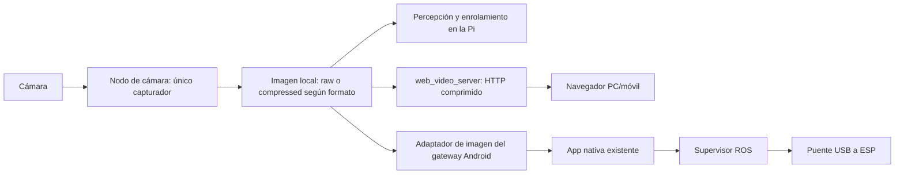

# Vídeo sin escritorio y ROS 2 en Raspberry Pi 3B

Fecha: 2026-11-19. Propuesta técnica tras revisar las opciones del usuario. No se instaló ni probó este pipeline en la Raspberry. Ubuntu Server 24.04 arm64 + ROS 2 Jazzy ros-base continúa como base; consola/SSH es la ruta recomendada para el siguiente banco. Xfce/LXQt queda opcional, sin instalar ni desinstalar nada en esta tarea.

## Recomendación

Empezar con un único nodo ROS propietario de la cámara y compartir sus imágenes entre percepción y visualización. Para el navegador, usar web_video_server como primer candidato integrado. No ejecutar uStreamer, OpenCV y otro nodo ROS abriendo el mismo dispositivo al mismo tiempo. Si se ensaya uStreamer, hacerlo en una prueba separada, sin procesos que compitan por la cámara.



La rama de vídeo no autoriza ni mantiene órdenes de motor. Un visor lento no debe bloquear control ni acumular imágenes antiguas.

## Opciones consideradas

| Opción | Uso previsto para LUMI | Dependencia y coste por verificar |
| --- | --- | --- |
| uStreamer/MJPEG | Prueba rápida de una cámara V4L2 y referencia de consumo, sin competir con ROS por el dispositivo | MJPEG nativo reduce necesidad de codificar. Si recibe raw, puede haber codificación por CPU; no asumir coste mínimo |
| ROS + web_video_server | Primer candidato de integración con IA y navegador | Comparar transporte compressed reutilizado frente a JPEG codificado desde raw; fijar versión y QoS compatibles con Jazzy |
| MediaMTX/RTSP/WebRTC | Alternativa si MJPEG ocupa demasiado Wi-Fi y hay H.264 eficiente disponible | MediaMTX distribuye/convierte protocolos; cambiar códec requiere codificación externa. Verificar cámara/driver/aceleración en Ubuntu, sin asumir encoder por hardware funcional |
| GStreamer/RTP-UDP | Comparación de latencia si las opciones anteriores no cumplen | Requiere diseñar codificación, receptor, buffers y pérdida de paquetes; no garantiza una latencia concreta solo por usar UDP |
| Foxglove/visor ROS remoto | Diagnóstico opcional de temas y estados desde otro equipo | No es necesario añadirlo al primer despliegue ni enviar imágenes raw al PC para visualizar |

Fuentes primarias: [uStreamer](https://github.com/pikvm/ustreamer), [web_video_server](https://github.com/RobotWebTools/web_video_server), [MediaMTX y recodificación](https://mediamtx.org/docs/features/remuxing-reencoding-compression), [GStreamer RTP/RTSP](https://gstreamer.freedesktop.org/documentation/additional/rtp.html).

## Selección del nodo de cámara

Si es USB/V4L2, comparar compatibilidad de usb_cam y v4l2_camera con el modelo y los formatos enumerados. No fijar driver por intuición ni instalar ambos como capturadores simultáneos.

[usb_cam](https://github.com/ros-drivers/usb_cam) documenta formatos y transporte comprimido; versiones del proyecto admiten publicación directa de MJPEG como CompressedImage. Verificar qué versión está disponible en Jazzy y el nombre exacto del formato antes de configurar. No confundir MJPEG recibido de cámara con decodificar a RGB y después volver a comprimir.

[v4l2_camera](https://index.ros.org/p/v4l2_camera/) integra image_transport y conversiones de formato. Confirmar el formato de entrada soportado por la versión concreta; instalar un plugin compressed no demuestra que se conserve el JPEG nativo de la cámara.

Para CSI, la detección y el controlador dependen del sensor y la pila de cámara en Ubuntu; no prometer que cualquier CSI aparecerá como /dev/video0 ni que un nodo V4L2 genérico la abrirá. Se mantiene pendiente el modelo de cámara doble lente. Identificar si son dos dispositivos, pares sincronizados o una imagen lado a lado. No reducir la imagen combinada a 640×480 sin separar y preservar la geometría prevista.

## Raw local y vídeo de red

El detector necesita píxeles decodificados. Una imagen raw dentro de la Pi puede ser apropiada; la compresión también consume CPU. Dos rutas candidatas:

- Cámara con MJPEG nativo: conservar bytes JPEG para visualización cuando driver/servidor lo permitan; decodificar localmente solo los frames que use percepción.
- Cámara con raw: compartir la captura con IA y codificar una copia de visualización a resolución/FPS medidos. Evitar codificaciones redundantes por cada cliente.

web_video_server ofrece MJPEG, snapshots y ros_compressed; usar la modalidad que realmente reutilice el mensaje comprimido en la versión instalada. Si se configura salida MJPEG desde raw, registrar el coste de codificación. Aislar el tráfico DDS de imagen a los procesos locales; el teléfono recibe HTTP, no tópicos ROS completos.

Ejemplo de coste sin comprimir: RGB8 a 640×480 y 15 FPS genera 640×480×3×15×8 ≈ 111 Mbit/s antes de sobrecargas. No generalizar ese número a otros formatos ni afirmar que cualquier publicación raw colapsa una red. Tampoco transmitir por Wi-Fi la imagen raw solo para verla en el teléfono.

## Encaje con Android existente

La app actual muestra JPEG individuales desde /foto.jpg y consulta /api/estado. No implementa un decodificador multipart MJPEG, RTSP ni WebRTC. No basta con cambiar /foto.jpg por /stream.

Primer paso de integración: conservar el contrato de snapshot y alimentar el gateway desde ROS, sustituyendo su captura OpenCV independiente. Conservar timestamps y una copia reciente compartida. El navegador puede usar el stream HTTP de web_video_server; Android mantendrá snapshots hasta decidir y medir una adaptación de streaming nativo. No reemplazar la app nativa por una web ni añadir un WebView solo por elegir HTTP.

Reservar 8080 al gateway existente de la Raspberry y, si se usa web_video_server, proponer 8081 para evitar conflicto. La ESP de banco sigue teniendo su servidor temporal en otro equipo/IP. Las URLs siguientes son ejemplos condicionados a nodos/temas configurados, no servicios ya desplegados:

```text
http://IP-PI:8081/stream?topic=/camera/image_raw&type=mjpeg
http://IP-PI:8080/foto.jpg
```

No abrir cámara para cada petición ni ejecutar inferencia dentro del handler HTTP. Publicar frames recientes con buffers cortos, timestamps y QoS comprobado. Revisar que no se mantenga una imagen congelada como si fuera vídeo actual; el supervisor debe seguir deteniendo órdenes caducadas aunque el vídeo continúe.

## Piloto y decisión basada en medidas

Configuración inicial propuesta: un canal RGB lógico a 640×480 y 10 FPS si está soportado y conserva el cuerpo en el encuadre. Después probar 15 FPS si memoria y CPU lo permiten. Frecuencia de inferencia y de visualización se miden por separado. No prometer 15–30 FPS ni latencias de 50/100/200 ms a partir del nombre del protocolo.

1. Registrar SO, arquitectura, cámara, formatos y revisión de paquetes. Confirmar acceso y geometría.
2. Probar captura sin IA, sin motores y con un solo visor. Medir CPU, RSS, temperatura, FPS y ancho de banda.
3. Probar ROS + visor comprimido. Si corresponde, ensayar por separado uStreamer como referencia sobre la misma cámara y configuración.
4. Medir antigüedad captura→visualización: filmar escena y pantalla con un cronómetro visible o método equivalente, con repeticiones. Registrar p50/p95, congelaciones y condiciones de Wi-Fi. Diferenciarlo del tiempo sensor→control y del tiempo de parada física.
5. Añadir detector/identificador y gateway Android; repetir las medidas, incluidas desconexión del visor y carga de red. Ninguna mejora de vídeo autoriza reanudar movimiento automáticamente.
6. Si MJPEG no cumple presupuesto de red, evaluar H.264/MediaMTX o GStreamer verificando primero el codificador disponible y su coste.

La selección final depende de la latencia aceptable para el ensayo físico, el rendimiento de identidad y el margen de CPU/RAM con todo activo. Si la Pi 3 no alcanza el presupuesto, registrar el límite y revisar configuración/alcance con el equipo, sin sacar inferencia a una API remota.

## Inventario desde consola en la Raspberry

Con la cámara USB conectada, sin activar captura ni motores:

```sh
cat /etc/os-release
uname -m
lsusb
sudo apt install v4l-utils
v4l2-ctl --list-devices
```

Después sustituir /dev/video0 por el dispositivo de captura identificado:

```sh
v4l2-ctl -d /dev/video0 --list-formats-ext
```

No todos los nodos /dev/video corresponden a captura de imagen; conservar el listado y confirmar antes de lanzar un nodo. Estas acciones se harán en la Raspberry del usuario: no se ejecutaron desde este PC. Compartir el modelo y formatos permitirá fijar driver y configuración de launch reproducibles.